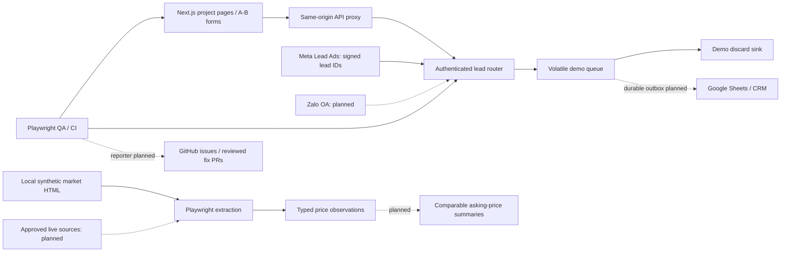

# SI Property Growth Ops

A public engineering pilot for real estate marketing and growth operations: multi-project Next.js campaign pages, authenticated lead routing, Meta lead-ID webhooks, a Playwright market-pricing fixture extractor, and browser regression QA. The seven-day backlog is designed for four parallel Devin Bot workstreams with reviewed GitHub PRs.

**Evidence first:** this repository was created from a written brief on 26 November 2026. The original local project/ZIP was unavailable. No claim is made that this is the original codebase, that historical tests were recovered, or that any live integration or campaign is deployed. All projects, contacts and market prices are synthetic.

[Live backlog](https://github.com/TriNhanDuong/siproperty-growth-ops/issues) · [Task specifications](BACKLOG.md) · [Architecture](ARCHITECTURE.md) · [Verification evidence](docs/verification/2026-11-26.md)

## Current state

| Component                           | Verified state                                                                                                                                                                        |
| ----------------------------------- | ------------------------------------------------------------------------------------------------------------------------------------------------------------------------------------- |
| Build (Windows)                     | PASS — TypeScript, Next.js and bundled router                                                                                                                                         |
| Unit/integration tests              | 53/53 passing; 0 failing; 0 skipped across 6 test files                                                                                                                               |
| Browser form/page E2E               | 6 passed / 8 failed / 0 skipped (14 cases; 2 confirmed failure groups)                                                                                                                |
| Scraper fixture smoke               | PASS — 2 valid synthetic observations, duplicate/incomplete rows excluded                                                                                                             |
| Dependency audit                    | 0 known vulnerabilities (npm audit, all severities)                                                                                                                                   |
| Meta lead ID receiver               | Implemented and tested locally: challenge, raw-byte HMAC, schema, idempotency. No Meta app subscription or live traffic verified.                                                     |
| Lead delivery                       | Authenticated local proxy → bounded in-memory queue → discard-only demo sink. No durable or external delivery.                                                                        |
| Zalo / Sheets / CRM / live scrapers | Scoped in LR-03/LR-04/LR-05/MS-01–04; not connected.                                                                                                                                  |
| Two historical form reports         | Original source/tests absent. Separately, the new suite exposes a confirmed 403 submission defect and strict-alert locator defect (QA-01/QA-02); 8 failing cases across two profiles. |

Local passing tests establish the new baseline only. Never infer that an unavailable historical bug has been fixed. See [the historical QA record](docs/qa/historical-form-reports.md).

## Architecture and data flow



Solid arrows are local implemented paths; dotted arrows are backlog scope. Scraped asking prices will be descriptive market data, not certified valuations.

## Run locally on Windows

Requires Node.js **24.12+** (Node 24 LTS recommended), npm and Git. The actual Windows verification used Node 26.13.1 / npm 11.20.0; CI also targets Node 24.

```powershell
npm ci --ignore-scripts
npm run verify
npx playwright install chromium
npm run test:scraper
npm run test:e2e
npm run dev
```

Open http://127.0.0.1:3000. The demo launcher supplies explicit synthetic settings for both local services and binds to loopback. Use **Demo Buyer / +12025550123** in forms. The token is server-only, browser fields are not persisted, and the UI states that no sales contact will be made. To run the built apps, use `npm run build` then `npm run start:demo`. Stop the launcher with Ctrl+C.

Copy `.env.example` to ignored local configuration only when wiring individual services; the demo launcher intentionally does not load production secrets. No real Meta/Zalo/Sheets credentials are needed for any baseline test. Real connectors require their corresponding issues and deployment gates.

## Four-bot execution plan

| Bot label            | Ownership                                                                         | Reviewable outcome                                                |
| -------------------- | --------------------------------------------------------------------------------- | ----------------------------------------------------------------- |
| `bot-1-landing-page` | LP-01–04; campaign templates, SEO, experiments, performance, packaging            | Typed project config; measured budgets; deployable artifact       |
| `bot-2-lead-webhook` | LR-01–06; Meta/Zalo adapters, durable queue, sinks, abuse controls                | Durable retry-safe lead pipeline with synthetic integration tests |
| `bot-3-scraper`      | MS-01–04; source approval, drift, observations, schedules                         | Bounded fixture-first scraper and attributable pricing summaries  |
| `bot-4-qa`           | QA-01–06; reproduced form/locator defects, accessibility, live smoke, PR reporter | Reproducible evidence, least-privilege reports and release gates  |

Bots can work concurrently on isolated branches. Changes to shared contracts need a reviewed coordination PR. No bot self-merge or production credentials in fork jobs. The repository does **not** configure or run Devin Bots by itself.

## Day 1–7 roadmap

| Day | Deliverables / checkpoint                                                                                                                                                                                                            |
| --- | ------------------------------------------------------------------------------------------------------------------------------------------------------------------------------------------------------------------------------------ |
| 1   | Fix the reproduced 403 and strict-alert locator defects in QA-01/02; retain all existing assertions; LP-01 typed config; LR-02 outbox migration proposal; MS-01 source-policy tests. Record baseline and starter tranche checkpoint. |
| 2   | Merge durable inbox/outbox + restart recovery; Meta detail adapter with mocked permission/429 failures; source policy review; first accessibility fixes.                                                                             |
| 3   | Zalo signed fixture integration and Sheets idempotency/reconciliation; DOM-drift adapter tests; consent-aware experiment adapter.                                                                                                    |
| 4   | CRM sink/redacted alerts; pricing observation store and unit-safe summaries; mobile lab performance budgets. Review top-up after the first ten substantive reviewed PRs if achieved.                                                 |
| 5   | Bounded scraper runner; container packaging; ingress rate limits and retention checks. Keep live sources off until approved.                                                                                                         |
| 6   | Opt-in deployed smoke configuration and QA reporter dry-run; replay/dead-letter drills; permission and data-retention review.                                                                                                        |
| 7   | Merge reviewed fixes, rerun Windows/Linux/browser checks, publish measured spend and daily PR evidence; decide whether production gates are met.                                                                                     |

Days are relative to grant activation, not a claim that any grant is approved. Dependencies in Issues take precedence; missed prerequisites move the dependent item rather than producing fake delivery claims.

## Requested compute allocation

These are **planning allocations**, not vendor rates, measured usage, or a promise that four bots run continuously for seven days on a fixed price. Four workstreams × seven days = 28 bot-days; the requested $750–$1,500 envelope averages $26.79–$53.57 per planned bot-day. Actual usage must be measured after the first tasks. Concurrency reduces calendar time and does not by itself prove cost.

| Workstream                     | Expected sessions (planning only)    | Requested credit allocation |
| ------------------------------ | ------------------------------------ | --------------------------- |
| Landing/config/performance     | 8–12                                 | $150–$300                   |
| Webhooks/durability/connectors | 12–18                                | $250–$450                   |
| Scraper/drift/data pipeline    | 8–12                                 | $175–$375                   |
| QA/reproduction/reviews        | 12–18                                | $175–$375                   |
| **Total**                      | **40–60 sessions, not yet measured** | **$750–$1,500**             |

Request one month of Devin Max separately, or a $500 starter tranche after the Day-1 checkpoint with a top-up review after ten substantive PRs merge. No purchases, recharge or grant acceptance are automated. [Devin's official pricing](https://devin.ai/pricing) lists Max at $200/month at review time and describes quota/extra usage; it provides no fixed bot-hour conversion used here.

[Poke's offer page](https://poke.com/bots), checked 26 November 2026, showed a zero countdown and Apple Messages-only offer. Outreach therefore asks for a discretionary manual review, with no claim of eligibility or availability. The private copy-paste outreach file is ignored by git.

## Production gates

This is a reviewer-ready starting point, **not a production-ready deployment**. Durable delivery, approved live sources, real integration permissions, retention/deletion, anti-abuse controls, deployed smoke evidence and operational ownership remain open issues. Read [SECURITY.md](SECURITY.md) before supplying any real data.
